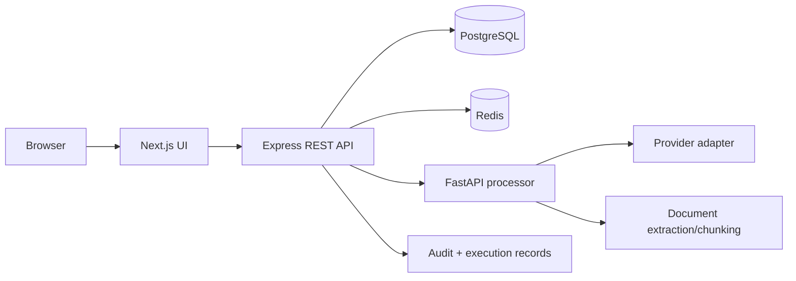

# Architecture and service boundaries

PostgreSQL is authoritative for organizations, memberships, agents, prompt versions, tools, documents, executions, approvals, usage and audit events. Express owns business rules and authorization. FastAPI owns bounded document processing and model-provider calls. Redis is used for ephemeral coordination/cache and can host BullMQ jobs in a production extension.

Tenant ID is derived from the authenticated membership context; clients cannot select another tenant by passing arbitrary tenant IDs. All resource queries include tenant scope.
